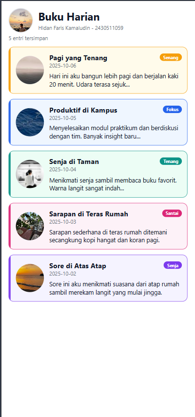

# Diary App - Praktikum 2 Mobile Programming

Aplikasi Buku Harian (Diary App) yang dibangun dengan **React Native + Expo CLI**.
Pertemuan 2 membahas struktur project, komponen dasar React Native, dan refactoring
menjadi reusable component.

## Data Mahasiswa

| | |
|---|---|
| Nama | Hldan Faris Kamaludin |
| NIM | 2430511059 |
| Mata Kuliah | Mobile Programming (Multiplatform) |
| Program Studi | Teknik Informatika, Fakultas Sains dan Teknologi, Universitas Muhammadiyah Sukabumi |

## Fitur yang Diselesaikan

- **Daftar entri diary** dengan 5 entri (3 entri dari modul + 2 entri baru) memakai
  `ScrollView`, `Text`, `Image`, dan `StyleSheet`.
- **Reusable component `DiaryCard`** — kartu dipisah ke `src/components/DiaryCard.js` dan
  data dikirim melalui **props** (`title`, `date`, `preview`, `mood`, `moodImage`, `moodUri`).
- **Header dengan avatar pengguna** menggunakan komponen `Image` (foto profil pada
  `assets/moods/avatar.jpg`).
- **Variasi tampilan kartu berdasarkan mood** — warna border/outline, warna latar kartu,
  dan badge mood menyesuaikan mood tiap entri (lihat `src/styles/moods.js`).
- **Pengelolaan aset gambar lokal dan remote** — sebagian entri memakai gambar lokal dari
  folder `assets/moods/`, sebagian lagi memakai URL gambar remote (`picsum.photos`).

## Struktur Folder

```
diary-app/
├── App.js                        # entry point + SafeAreaProvider
├── assets/
│   ├── moods/                    # aset gambar mood & avatar
│   │   ├── avatar.jpg            # foto profil pengguna (header)
│   │   ├── pagi.jpg              # mood "Senang"
│   │   ├── sore.jpg              # mood "Senja"
│   │   ├── terasrumah.jpg        # mood "Santai"
│   │   └── *.png                 # ikon mood cadangan
│   └── ...                       # icon & splash bawaan template
├── screenshots/                  # dokumentasi tampilan aplikasi
├── src/
│   ├── components/
│   │   └── DiaryCard.js          # kartu diary (reusable component)
│   ├── screens/
│   │   └── DiaryListScreen.js    # halaman daftar entri
│   └── styles/
│       └── moods.js              # tema tampilan kartu per mood
├── eslint.config.js
├── app.json
└── package.json
```

## Cara Menjalankan Project

Prasyarat: **Node.js LTS**, **Expo Go** (Android/iOS), dan HP + laptop pada jaringan Wi-Fi
yang sama.

```bash
# 1. Install dependency
npm install

# 2. Jalankan development server
npx expo start
```

3. Scan QR code yang muncul di terminal menggunakan aplikasi **Expo Go**, atau tekan:
   - `a` untuk membuka di Android Emulator,
   - `w` untuk mengecek di browser,
   - `i` untuk membuka di iOS Simulator.

Untuk menghentikan server tekan `Ctrl + C`. Jika terjadi masalah cache, jalankan
`npx expo start -c`.

Pemeriksaan kode (lint):

```bash
npx expo lint
```

## Library yang Digunakan

| Library | Fungsi |
|---|---|
| `expo` | Platform dan toolchain pengembangan |
| `expo-status-bar` | Pengaturan status bar aplikasi |
| `react-native` | Framework UI lintas platform |
| `react-native-safe-area-context` | Menangani area aman (notch/status bar) |
| `react-native-web` | Adapter React Native agar bisa dirender di browser |
| `react-dom` | Renderer DOM untuk target web |
| `@expo/metro-runtime` | Runtime Metro untuk web (hot reload) |

## Screenshot

### Tampilan Utama



Halaman daftar entri Buku Harian beserta header profil pengguna dan kartu-kartu diary
bervariasi sesuai mood. Diambil dari render web (`http://localhost:8081`) pada
layar 400 x 852.

### Dokumentasi Lainnya

Terdapat pada folder `screenshots/`:

- `01-daftar-entri.png` — tampilan daftar entri pada layar ponsel (412 x 915).
- `02-variasi-mood.png` — seluruh isi daftar, memperlihatkan perbedaan border/outline
  dan badge mood pada tiap kartu.
- `03-tampilan-lebar.png` — tampilan pada layar lebar (768 x 1000).

> Catatan: seluruh file screenshot di atas dihasilkan dari render web atas komponen
> React Native yang sama (react-native-web). Untuk pengumpulan, silakan ambil ulang
> screenshot langsung dari aplikasi yang berjalan di Expo Go / emulator.
