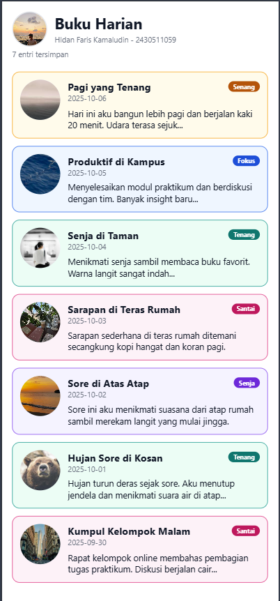
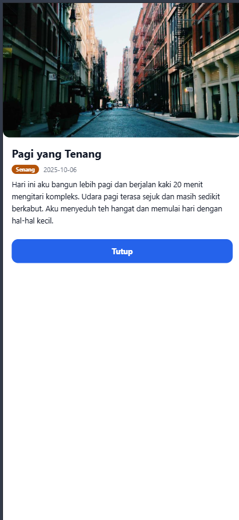

# Diary App - Praktikum 3 Mobile Programming

Aplikasi Buku Harian (Diary App) berbasis **React Native + Expo CLI**.
Project ini merupakan **lanjutan** dari Diary App Pertemuan 2 (yang masih memakai
`ScrollView` dengan kartu statis). Pada Pertemuan 3 aplikasi dikembangkan menjadi
antarmuka yang **terstruktur, responsif, dan interaktif**.

## Data Mahasiswa

| | |
|---|---|
| Nama | Hldan Faris Kamaludin |
| NIM | 2430511059 |
| Mata Kuliah | Mobile Programming (Multiplatform) |
| Program Studi | Teknik Informatika, Fakultas Sains dan Teknologi, Universitas Muhammadiyah Sukabumi |

## Ringkasan Perubahan dari Pertemuan 2

| Aspek | Pertemuan 2 | Pertemuan 3 |
|---|---|---|
| Daftar entri | `ScrollView` | `FlatList` |
| Jumlah kolom | Selalu 1 kolom | 1 kolom, otomatis 2 kolom jika lebar `>= 600 px` |
| Style | Angka & warna ditulis langsung di komponen | Design tokens terpusat di `tokens.js` |
| Kartu | `View` statis | `Pressable` (bisa ditekan) |
| Interaksi | Tidak ada | Modal detail saat kartu ditekan |
| Aksesibilitas | Belum | `accessibilityLabel`, `accessibilityRole`, kontras, target sentuh |
| Data | 5 entri | 7 entri |

---

## Fitur yang Ditambahkan di Praktikum 3

### 1. Design Tokens (`src/styles/tokens.js`)

Seluruh nilai desain dipusatkan dalam satu file sehingga tampilan konsisten dan
mudah diubah:

| Token | Isi |
|---|---|
| `COLORS` | `surface`, `border`, `text`, `muted`, `accent`, `heroPlaceholder`, `moodPlaceholder` |
| `SPACE` | `xs: 4`, `s: 8`, `m: 12`, `l: 16`, `xl: 24` |
| `RADIUS` | `card: 12`, `avatar: 32`, `badge: 10` |
| `TYPO` | `h1: 24`, `title: 16`, `body: 14`, `caption: 12` |
| `BREAKPOINTS` | `tablet: 600` (px) |
| `MOOD_THEME` | `label`, `border`, `background`, `badge`, `badgeText` per mood |

Tidak ada lagi warna atau ukuran yang di-hardcode di dalam komponen. Tema mood
dari Pertemuan 2 juga ikut dipindahkan ke sini (`getMoodTheme()`), sehingga file
lama `src/styles/moods.js` tidak diperlukan lagi.

### 2. Daftar Responsif dengan `FlatList`

`ScrollView` diganti `FlatList` agar daftar panjang tetap efisien (hanya item yang
terlihat yang dirender). Jumlah kolom mengikuti lebar layar:

```js
const { width } = useWindowDimensions();
const twoCols = width >= BREAKPOINTS.tablet;
```

- **`numColumns`** diatur `twoCols ? 2 : 1`.
- **`key={keyForCols}`** membuat FlatList dipasang ulang saat jumlah kolom berubah
  (React Native tidak mengizinkan `numColumns` diubah on-the-fly).
- **`columnWrapperStyle`** hanya diberikan saat 2 kolom, untuk memberi jarak
  antarkolom.
- **Header** (avatar, nama, jumlah entri) dirender lewat `ListHeaderComponent`,
  jadi ikut ter-scroll bersama daftar.
- **`ListEmptyComponent`** disiapkan untuk keadaan data kosong.

### 3. `DiaryCard` Interaktif (`src/components/DiaryCard.js`)

Kartu dibungkus `Pressable` sehingga seluruh area kartu dapat ditekan:

- `onPress` membuka modal detail entri terpilih.
- `android_ripple` memberi umpan balik sentuhan di Android.
- `({ pressed }) => opacity` memberi umpan balik visual di semua platform.
- Properti **`variant`** membedakan tampilan:
  - `list` - gambar mood di kiri, teks di kanan (1 kolom).
  - `grid` - gambar mood di atas, teks di bawah (2 kolom).
- Tetap mendukung **gambar lokal** (`moodImage` hasil `require`) maupun
  **gambar remote** (`moodUri`), serta **badge mood** dari Pertemuan 2.

### 4. `DiaryDetailModal` (`src/components/DiaryDetailModal.js`)

Modal baru yang tampil di atas layar tanpa berpindah screen:

- **Hero image** dengan `aspectRatio: 16 / 9` agar tingginya selalu proporsional
  di berbagai ukuran layar.
- Judul, **badge mood**, tanggal, dan **isi lengkap** entri (`body`).
- Tombol **Tutup** (`minHeight: 44`) untuk menutup modal.
- `onRequestClose` supaya tombol back Android juga menutup modal.
- Isi dibungkus `ScrollView` agar teks panjang tidak terpotong.

### 5. Aksesibilitas Dasar

- **`accessibilityLabel`** pada setiap kartu
  (`Entri <judul> tanggal <tanggal>, mood <mood>`) dan pada tombol Tutup
  (`Tutup detail entri`), plus `accessibilityRole="button"`.
- **Kontras teks** - teks utama `#111827` di atas `#FFFFFF` (16.1:1) dan teks
  sekunder `#6B7280` di atas `#FFFFFF` (4.9:1). Setiap mood punya token
  `badge`/`badgeText` sendiri dengan kontras minimal **4.5:1** (WCAG AA). Contoh:
  mood `Senang` memakai badge `#B45309` (bukan warna border `#F59E0B` yang hanya
  mencapai 2.1:1 bila teksnya putih).
- **Target sentuh** - tombol Tutup diberi `minHeight: 44` (standar Apple HIG /
  WCAG 2.5.5), dan seluruh area kartu dapat ditekan, bukan hanya ikon atau judul.

### 6. Dua Entri Diary Baru

Data bertambah dari 5 menjadi **7 entri**, sehingga pengujian daftar 1 kolom,
grid 2 kolom, dan modal jadi lebih mudah:

| id | Judul | Tanggal | Mood | Gambar |
|---|---|---|---|---|
| 1 | Pagi yang Tenang | 2025-10-06 | Senang | lokal `pagi.jpg` |
| 2 | Produktif di Kampus | 2025-10-05 | Fokus | remote |
| 3 | Senja di Taman | 2025-10-04 | Tenang | remote |
| 4 | Sarapan di Teras Rumah | 2025-10-03 | Santai | lokal `terasrumah.jpg` |
| 5 | Sore di Atas Atap | 2025-10-02 | Senja | lokal `sore.jpg` |
| **6** | **Hujan Sore di Kosan** | 2025-10-01 | Tenang | remote |
| **7** | **Kumpul Kelompok Malam** | 2025-09-30 | Santai | remote |

### 7. Integrasi `App.js`

`DiaryListScreen` dibungkus `SafeAreaProvider` + `SafeAreaView` dari
`react-native-safe-area-context`, dan ditambahkan `StatusBar` (`expo-status-bar`).

---

## Penyelesaian Tugas Praktikum

| # | Ketentuan Tugas | Status | Dikerjakan di |
|---|---|---|---|
| 1 | Terapkan design tokens dan StyleSheet konsisten pada seluruh komponen | Selesai | `src/styles/tokens.js`, dipakai di `DiaryCard`, `DiaryDetailModal`, `DiaryListScreen` |
| 2 | FlatList responsif: 1 kolom di ponsel, 2 kolom saat `width >= 600 px` | Selesai | `src/screens/DiaryListScreen.js` (`numColumns`, `useWindowDimensions`, `keyForCols`) |
| 3 | Tambahkan `DiaryDetailModal` dan buka saat `DiaryCard` ditekan | Selesai | `src/components/DiaryDetailModal.js` + `onPress` di `DiaryCard` |
| 4 | Aksesibilitas: `accessibilityLabel`, kontras teks, target sentuh layak | Selesai | `accessibilityLabel`/`accessibilityRole` di kartu & tombol, token `badge`/`badgeText`, `minHeight: 44` |
| 5 | Tambahkan minimal dua entri diary baru | Selesai | Entri id 6 & 7 di `DiaryListScreen.js` (total 7 entri) |
| 6 | Sertakan dua screenshot: 1 kolom dan 2 kolom | Selesai | `screenshots/p3-1kolom.png`, `screenshots/p3-2kolom.png` |
| 7 | Penjelasan singkat cara kerja breakpoint 600 px | Selesai | Bagian [Cara Kerja Breakpoint 600 px](#cara-kerja-breakpoint-600-px) |

### Berkas Pengumpulan

- Source code project (tanpa folder `node_modules` saat dikompres).
- Screenshot tampilan 1 kolom dan 2 kolom (folder `screenshots/`).
- README ini (nama, NIM, cara menjalankan project, dan fitur yang diselesaikan).

---

## Struktur Folder

```
diary-app/
├── App.js                        # entry point + SafeAreaProvider + StatusBar
├── assets/
│   ├── moods/                    # aset gambar mood & avatar
│   │   ├── avatar.jpg            # foto profil pengguna (header)
│   │   ├── pagi.jpg              # gambar entri "Pagi yang Tenang"
│   │   ├── sore.jpg              # gambar entri "Sore di Atas Atap"
│   │   ├── terasrumah.jpg        # gambar entri "Sarapan di Teras Rumah"
│   │   └── *.png                 # ikon mood cadangan
│   └── ...                       # icon & splash bawaan template
├── screenshots/
│   ├── p3-1kolom.png             # tampilan daftar 1 kolom
│   └── p3-2kolom.png             # tampilan daftar 2 kolom
├── src/
│   ├── components/
│   │   ├── DiaryCard.js          # kartu diary (reusable + Pressable)
│   │   └── DiaryDetailModal.js   # modal detail entri
│   ├── screens/
│   │   └── DiaryListScreen.js    # daftar entri (FlatList responsif)
│   └── styles/
│       └── tokens.js             # design tokens + tema mood
├── eslint.config.js
├── app.json
└── package.json
```

## Cara Menjalankan Project

Prasyarat: **Node.js LTS** dan **Expo Go** (Android/iOS). Untuk mencoba di HP,
HP dan laptop harus berada pada jaringan Wi-Fi yang sama.

```bash
# 1. Install dependency
npm install

# 2. Jalankan development server
npx expo start
```

3. Scan QR code yang muncul di terminal menggunakan aplikasi **Expo Go**, atau tekan:
   - `a` untuk membuka di Android Emulator,
   - `w` untuk membuka di browser (web),
   - `i` untuk membuka di iOS Simulator (khusus macOS).

Untuk mencoba langsung di browser:

```bash
npm run web
```

Menghentikan server: `Ctrl + C`. Jika terjadi masalah cache:
`npx expo start -c`.

Pemeriksaan kode (lint):

```bash
npx expo lint
```

> Catatan Windows/PowerShell: jika muncul pesan
> `npx.ps1 cannot be loaded because running scripts is disabled`, jalankan
> `Set-ExecutionPolicy -Scope CurrentUser RemoteSigned`, atau gunakan `npx.cmd`.

## Cara Kerja Breakpoint 600 px

Jumlah kolom ditentukan sepenuhnya oleh **lebar layar yang terbaca saat itu**,
bukan oleh platform atau ukuran perangkat yang di-hardcode.

1. `useWindowDimensions()` memberikan `width` terkini dan **memaksa render ulang**
   setiap kali ukuran jendela atau orientasi berubah.
2. Nilai itu dibandingkan dengan token `BREAKPOINTS.tablet` (600):

   ```js
   const { width } = useWindowDimensions();
   const twoCols = width >= BREAKPOINTS.tablet;
   ```

3. Kalau `twoCols` bernilai `false` (lebar < 600 px, tipikal ponsel), `FlatList`
   memakai `numColumns={1}` dan kartu ditampilkan dengan `variant="list"`
   (gambar di kiri, teks di kanan).
4. Kalau `twoCols` bernilai `true` (lebar >= 600 px, tipikal tablet atau jendela
   browser yang dilebarkan), `FlatList` memakai `numColumns={2}`, kartu memakai
   `variant="grid"` (gambar di atas, teks di bawah), dan `columnWrapperStyle`
   menambahkan jarak antarkolom.
5. `numColumns` **tidak boleh diubah saat FlatList sudah terpasang**. Karena itu
   `key` FlatList dibuat ikut berubah:

   ```js
   const keyForCols = useMemo(() => (twoCols ? 'grid2' : 'list1'), [twoCols]);
   ```

   Perubahan `key` membuat FlatList dipasang ulang dengan struktur kolom baru,
   sehingga tidak ada kartu yang tertinggal atau berantakan saat rotasi.

6. Kartu pada baris terakhir grid memakai `flex: 1 / 2`, jadi bila jumlah entri
   ganjil (7 entri) kartu terakhir tetap selebar satu kolom dan tidak melar
   memenuhi baris.

Angka **600** dipilih karena lebar ponsel umumnya 320-480 px, sedangkan tablet
dimulai dari 600 px (setara `sw600dp` pada Android). Dengan batas ini ponsel
selalu mendapat 1 kolom yang nyaman dibaca, sementara layar lebar memanfaatkan
ruangnya untuk 2 kolom tanpa perlu mendeteksi jenis perangkat.

## Screenshot

### Tampilan 1 Kolom (lebar layar < 600 px)



Kartu ditampilkan penuh satu baris: gambar mood di kiri, lalu judul + badge mood +
tanggal + cuplikan isi di kanan.

### Tampilan 2 Kolom (lebar layar >= 600 px)



Daftar berubah menjadi grid dua kolom dengan gambar mood di atas dan teks di
bawah. Perubahan terjadi otomatis saat lebar layar mencapai 600 px.

## Library yang Digunakan

| Library | Fungsi |
|---|---|
| `expo` | Platform dan toolchain pengembangan |
| `expo-status-bar` | Pengaturan status bar aplikasi |
| `react-native` | Framework UI lintas platform |
| `react-native-safe-area-context` | Menangani area aman (notch/status bar) |
| `react-native-web` | Adapter React Native agar bisa dirender di browser |
| `react-dom` | Renderer DOM untuk target web |
| `@expo/metro-runtime` | Runtime Metro untuk web (hot reload) |
